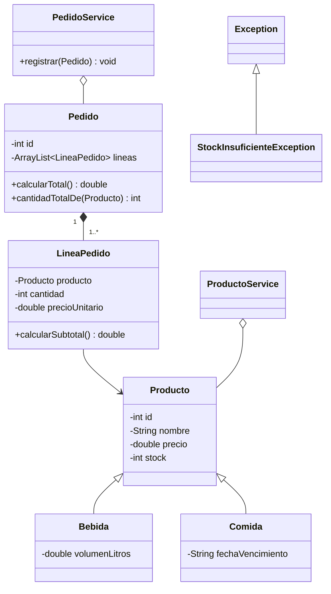

# Sistema de Gestión TechLab

Aplicación de consola en Java para **registrar, consultar y administrar productos** y **crear pedidos** con control de stock.

Proyecto realizado como preentrega del curso **Back-End Java** de Talento Tech.

## Tecnologías

- Java 25 (Eclipse Temurin)
- IntelliJ IDEA
- Sin dependencias externas: solo la biblioteca estándar de Java

## Cómo ejecutarlo

### Desde IntelliJ IDEA

1. Abrir la carpeta del proyecto con **File → Open**.
2. Verificar que el SDK sea Java 25 en **File → Project Structure → Project**.
3. Ejecutar `src/com/techlab/Main.java`.

### Desde la terminal

Desde la raíz del proyecto:

```bash
javac -encoding UTF-8 -d out --source-path src src/com/techlab/Main.java
java -cp out com.techlab.Main
```

## Funcionalidades

```
===================================
    SISTEMA DE GESTIÓN - TECHLAB
===================================
1) Agregar producto
2) Listar productos
3) Buscar/Actualizar producto
4) Eliminar producto
5) Crear un pedido
6) Listar pedidos
7) Salir
```

| Opción | Descripción |
|---|---|
| **Agregar producto** | Alta de un producto genérico, una bebida (con volumen en litros) o una comida (con fecha de vencimiento). El ID se asigna automáticamente. |
| **Listar productos** | Muestra todos los productos con su ID, nombre, precio, stock y datos específicos según el tipo. |
| **Buscar/Actualizar producto** | Búsqueda por ID o por nombre (parcial y sin distinguir mayúsculas). Permite actualizar el precio o el stock. |
| **Eliminar producto** | Baja por ID, con confirmación previa. |
| **Crear un pedido** | Permite elegir varios productos y cantidades, muestra el total y, al confirmar, descuenta el stock. |
| **Listar pedidos** | Muestra cada pedido con sus líneas, subtotales y total. |

### Validaciones

- Precio y stock no pueden ser negativos.
- Los datos numéricos inválidos (por ejemplo, `"diez"`) no cierran el programa: se vuelven a pedir.
- Los precios aceptan tanto coma como punto decimal (`10,50` o `10.50`).
- Un pedido no se puede confirmar si algún producto no tiene stock suficiente.

## Estructura del proyecto

```
src/com/techlab/
├── Main.java                          Menú e interacción con el usuario
├── productos/
│   ├── Producto.java                  Clase base: id, nombre, precio y stock
│   ├── Bebida.java                    Producto + volumen en litros
│   ├── Comida.java                    Producto + fecha de vencimiento
│   └── ProductoService.java           Alta, búsqueda, listado y baja de productos
├── pedidos/
│   ├── LineaPedido.java               Un producto, una cantidad y su precio unitario
│   ├── Pedido.java                    Conjunto de líneas, con su total
│   └── PedidoService.java             Registro de pedidos y descuento de stock
└── excepciones/
    └── StockInsuficienteException.java
```

## Diagrama de clases



## Decisiones de diseño

- **Separación en capas.** `Main` se encarga de toda la interacción con el usuario (leer e imprimir). Los *services* contienen la lógica y no usan `Scanner` ni `System.out`, por lo que podrían reutilizarse con otra interfaz, como una API REST.
- **Encapsulamiento con validación.** Todos los atributos son `private`. Los setters validan los datos y lanzan `IllegalArgumentException` ante valores inválidos. El constructor reutiliza esos setters, así que la regla de validación existe en un solo lugar.
- **IDs que no se reutilizan.** Cada clase usa un contador `static`. Los IDs no se reciclan al eliminar, para que un pedido nunca quede apuntando a otro producto. El ID se asigna después de validar, así que un producto rechazado no consume un número.
- **Precio histórico.** `LineaPedido` guarda el precio del producto al momento de crearse. Si el precio cambia después, los pedidos anteriores conservan su total original.
- **Registro de pedidos en dos fases.** `PedidoService.registrar` primero valida el stock de todas las líneas y recién después descuenta. Si un producto no alcanza, se lanza `StockInsuficienteException` y no se modifica ningún stock: o se aplica todo el pedido, o nada.
- **Validación por cantidad total.** Si el mismo producto aparece en varias líneas de un pedido, se valida la suma de sus cantidades (`Pedido.cantidadTotalDe`), no cada línea por separado.
- **Excepción *checked* para el stock.** `StockInsuficienteException` extiende `Exception`, así que el compilador obliga a manejarla. Es una situación esperable del negocio, a diferencia de un precio negativo, que es un error de quien llama.
- **Copias defensivas.** `listar()` y `getLineas()` devuelven una copia de la lista interna, para que no pueda modificarse desde afuera.
- **Herencia y polimorfismo.** `Bebida` y `Comida` extienden `Producto` y sobrescriben `toString()`. El resto del sistema (listados, pedidos y services) trabaja con `Producto` y funciona con cualquier subclase sin cambios.

## Autor

Nicolás Zalazar
